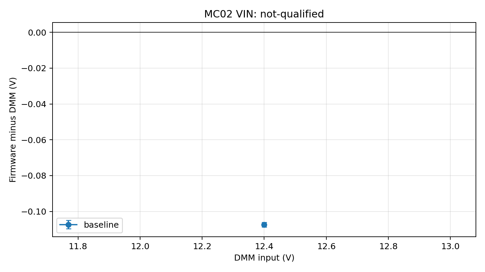

# 11 电阻分压摇杆按键：档位判据、去抖与容错（写给零基础）

> 本篇回答的问题：
> 1. 一块 LCD 模组上的"五向摇杆"到底是怎么接到单片机上的？为什么只需要 **1 根 ADC 线**？
> 2. 什么叫"档位判据"？阈值定在哪里才安全？
> 3. 为什么按键必须**去抖**？不做去抖会出现什么奇怪现象？
> 4. 实测说这个模组的 ADC "抖得很厉害"时，软件该怎么兜？
>
> 对应代码：`modules/lcd/lcd_task.c` 的 `lcd_key_read()` / `lcd_key_update()` /
> `lcd_module_presence_check()`，以及 P4 页的 `KEY raw:` 调试行。

---

## 1. 五向摇杆是怎么接的

一个"五向摇杆"（上下左右 + 中键按下）如果每个方向都拉一根 IO，就要 5 根线。
实际产品几乎都用**电阻分压**方案：把 5 个开关接到不同的分压电阻上，共用一根线输出
一个**随按键变化**的电压，单片机用 **1 路 ADC** 就能读出"现在按的是哪个键"。

本工程实测的档位（16bit ADC 口径）：

```
按键          16bit ADC 读数
空闲(不按)    64000 ~ 65300
中键按下      0 ~ 3200
触点 A        11200 ~ 16000
触点 B        24000 ~ 28800
触点 C        35200 ~ 40000
触点 D        44800 ~ 56000
```

判据就是**区间比较**：

```c
if (raw < 3200)  return KEY_MID;
if (raw >= 11200 && raw < 16000) return KEY_A;
/* ... */
return KEY_NONE;      /* 落在"缝隙"里 → 认为没按任何键 */
```

---

## 2. 档位判据的三条经验

### 2.1 阈值之间要留"缝隙"，缝隙是好事

相邻档位之间故意留一段"什么都不算"的区间。它的作用不是浪费，而是**容错**：

- 正常按键的读数在 ±5% 内漂移时，仍然稳稳落在自己的区间里；
- 真正落在缝隙里，说明读数"不正常"（模组拔掉、接触不良、供电异常），
  可以专门处理（本工程就用它检测"模组是否在位"）。

### 2.2 阈值要按**实测**定，不要照抄例程

本工程最初的阈值来自板级例程（12bit ADC 口径），再简单地 `×16` 换算到 16bit：

```c
#define ADC16(adc12) ((uint16_t)((adc12) * 16u))
```

这个换算只在"两边 ADC 参考电压、分压电阻都一样"时才成立。所以 P4 页专门留了一行：

```
KEY  raw:64767 min:0
```

- `raw`：**当前**实时 ADC 值（按住某个方向不放，屏幕上就会显示该方向的读数）；
- `min`：**上电以来见过的最小值**——"中键按下"会产生最小值，所以只要按住中键看一眼
  `min`，就知道中键的真实档位值是多少，**即使这个键因为阈值不对而没被识别**，
  也能据此把阈值改对。

> 这条经验很通用：**当"输入没被识别"时，先把原始值打出来看，不要靠猜。**

### 2.3 不要用"看起来合理"的保护把有效数据吃掉

本工程踩过的典型坑：

```c
/* 原来的写法 */
if (raw < 100)                 /* 认为"悬空/模组拔掉" */
    return LCD_KEY_NONE;
if (raw < 3200)                /* 中键 */
    return LCD_KEY_MID;
```

防"悬空"本身没错，但**中键按下时 ADC 本来就趋近 0**——两个判断都把 0 附近当特殊值，
结果就是**中键时灵时不灵**。

正确做法：先用**实测**确认"模组拔掉时读数是多少"。本工程实测是 **~5900**
（落在档位缝隙里），根本不会出现在 0 附近，所以那条 `< 100` 的保护可以直接删掉。

> 原则：**任何"保护性判断"都要能说清楚它防的是什么现象，并且有实测数据支撑。**
> 否则它很容易变成"把好数据也一起挡掉"的元凶。

---

## 3. 为什么必须去抖

### 3.1 抖动的两个来源

1. **机械抖动**：开关触点在闭合瞬间会弹跳几毫秒（classic bounce）；
2. **电气/电源抖动**：ADC 参考电压、模组供电不稳，读数会在几十~几千 LSB 之间漂。

本工程实测以第二种为主——空闲时读数在 58000~65000 之间晃，单次采样的极差能到 **6000+**。
这意味着会出现这种序列：

```
某一帧采样: raw = 52000  → 落在"触点 D"档 → 被识别成"某个方向按下"!
下一帧:     raw = 62000  → 又回到"空闲"
```

### 3.2 不去抖会怎样（本工程实际遇到的两种现象）

| 现象 | 原因 |
|---|---|
| "长按"时灵时不灵 | 长按过程中偶发一两帧读不到键，按住时长被重置 → 长按被截断成好几次短按 |
| 没按任何键，却突然进标定 / 翻页 | 空闲抖动瞬间落进某个档位，被判成按键 |

### 3.3 本工程的去抖实现：状态机 + 连续确认

按键任务不再直接读取 DMA 缓冲区，而是先调用生产接口 `BSP_ADCGetSample()`。接口只有在 DMA 已运行、发布过完整批次、没有 ADC 错误且样本不超过 20ms 时才返回 `BSP_ADC_STATUS_VALID`。

```c
LcdKey_e key = lcd_key_read();
uint8_t valid = (uint8_t)(lcd_adc_sample_valid && lcd_raw_valid_level(lcd_key_raw));
LCDKeyInputUpdate(&lcd_key_input, valid, key, HAL_GetTick(), &key_event);
```

`LCDKeyInputUpdate()` 只在连续 3 次新鲜采样确认按下／松开时发出事件。如果 ADC 未就绪、过期、报错，或原始值落在已知按键档位的缝隙里，它会清空候选键与按住状态，不产生“松开”事件。这样不会把“没有可用数据”折算成原始值 0，再误认成中键；也不会把采样失效误作松手而触发长按标定。

正常的按键抖动仍按原规则处理：按下期间读到其他有效键位会保留按住状态，松开需要连续三次有效的“无键”样本。ADC 失效则不同，它会取消整段手势。这个区别是故障安全边界的一部分。

---
## 4. 重要教训：在位检测不能和按键检测互相干扰

为了支持"热插拔 LCD 模组"，本工程写了在位检测：

```
扫描最近 10 次采样:
  - 读数落在"档位缝隙"        → 认定模组不在位(拔掉了)
  - 读数在"空闲带"内但极差过大 → 也认定不在位(抖动)
```

第二条判据在实测中直接把正常模组判成了"拔出"（本模组空闲极差就有 6000+），于是出现：
**数值区停止刷新（屏幕像卡死）+ 反复重初始化面板（屏幕闪）**。

更糟的是，我曾顺手加了一条"模组不在位就不响应按键"的保护——而**按住按键时读数本来就会
剧烈变化**，在位检测于是把"正在按键"判成"拔出"，按键被整个屏蔽掉。

**教训**：

> 同一个物理量（ADC 读数）同时用于两种判断时，必须检查它们的判据会不会互相误伤。
> 正确的分工是：
> - **在位检测**只看"是否落在档位缝隙"（拔掉时读数稳定在 ~5900，特征明确）；
> - **按键检测**只做去抖，不依赖在位标志。

---

## 5. 交互设计：按键分档不能有"空洞"

本工程最初的按键定义：

| 按住时长 | 行为 |
|---|---|
| ≤1s | 短按（翻页 / 冻结） |
| 1~1.5s | **什么都不做** |
| 1.5~3s | 面板重初始化 |
| ≥3s | 进标定 |

看起来"分得很细"，但用户**不可能精确控制自己按了多久**。按了 1.2 秒松手 →
三个功能一个都不触发 → 体感就是"按键坏了"。更麻烦的是：**冻结只能用短按解**，
而用户习惯"长按"，于是屏幕"一直冻结"解不开。

**改后（现行）**：

| 按住时长 | 行为 |
|---|---|
| < 1.5s 上/下 | 翻页 |
| < 1.5s 中键 | 冻结 / 恢复 |
| ≥ 1.5s 中键 | 面板重初始化 **+ 解除冻结** |
| ≥ 1.5s 左/右 | 进入按需 IMU 标定 |

三条设计原则：

1. **阈值只有一档**（1.5s），没有含糊的中间地带；
2. **破坏性动作（标定会让机器人失能）放在不常用的键上**（左右），而且要按住较久，
   降低误触概率；
3. **"重置"类操作顺手解除"冻结"**，给用户一条永远能回到正常状态的路径。

---

## 6. 速查表

| 现象 | 先查什么 |
|---|---|
| 某个方向完全无反应 | 该方向的档位在 `lcd_key_read()` 里处理了吗？阈值和实测对得上吗（用 `min` 值读实测）？ |
| 按键时灵时不灵 | 有没有去抖？原始读数抖动多大？（把 `raw` 打出来看极差） |
| 长按总被当成短按 | 长按期间是否被打断（抖动 / 缺去抖 / 中间时间档被丢弃） |
| 没按键却触发功能 | 空闲电平是否抖到相邻档位？缝隙够不够宽？ |
| 屏幕像卡死 | 是不是"刷新被某个标志挡住了"（冻结 / 模组不在位 / 标定提示） |
| 一时查不出原因 | **把原始 ADC 值打到屏幕上**，按住键逐档读一遍，再定阈值 |

---

## 7. ADC DMA 批次、新鲜度与失效处理

ADC1 依次读取 PC4 的 VCC_IN 和 PA5 的按键输入，所以 DMA 缓冲区是 `VIN, KEY, VIN, KEY...` 的成对数据。缓冲区保存 32 对读数；前后半段各完成 16 对后，回调分别对两个通道取平均，再更新原始读数、序号和 HAL tick 时间。程序处理刚采好的半段，DMA 继续写另一半，不必为每对采样都进入中断。

STM32H7 开启数据缓存时，DMA 已经把新数据写进 SRAM，CPU 仍可能读到缓存里的旧内容。启动采集前，先处理整块缓冲区的旧缓存，避免旧内容稍后写回内存时覆盖 DMA 的新数据；完成回调再舍弃已采好半段的旧缓存，然后计算平均值。缓存操作以 32 字节为一组，缓冲区的起点和每半段长度都按整组安排，避免同时影响旁边的数据。

`sequence` 说明“是否又完成了一批”，`timestamp_ms` 说明“这批数据是什么时候完成的”。重复读取不会增加序号或更新时间；过去的时间不超过 20ms 才可用，等于 20ms 仍允许，超过后返回过期。用无符号减法计算时间差，可以处理 HAL tick 从最大值回到 0 的情况。加热控制还会检查电压换算配置、电压是否为正常数字及是否在允许范围内，检查失败就把 PWM 设为零。

VREF 默认 3.3V、分压比默认 1:11，来自软件配置。主机测试能检查换算公式和失效后的处理，板上电阻、参考电压及整条输入链的实际精度还需要在受控供电条件下用仪表测量。

### 7.1 按接口状态使用采样结果（MC02-0110）

第三批注释整理对应检查清单024、025，入口是 [bsp_adc.h](../../bsp/adc/bsp_adc.h) 和 [bsp_adc.c](../../bsp/adc/bsp_adc.c)。阅读时先分清原始采样和电压换算，再看接口按什么顺序检查数据。

- `BSP_ADCInit()` 在 `MX_DMA_Init()`、`MX_ADC1_Init()` 之后，由 `BSPInit()` 启动时调用。它先清除旧记录，再校准 ADC 和启动 DMA；任一步失败都记下错误并返回。刚启动时，还要等半段数据采完才能使用。它不负责停止已运行的 DMA，采集中不要重复调用。
- `BSP_ADCGetSample()` 先检查输出指针，再检查错误、是否已完成采样、是否超过 20ms。传入 `NULL` 返回参数错误；指针非空时，即使返回未就绪、过期或报错，也会填入最近的数据和错误信息，不能靠“输出是否为 0”判断能否使用。
- 返回 `BSP_ADC_STATUS_VALID` 表示 `raw_vcc_in` 和 `raw_key` 可用。电压换算配置不合要求时，仍可返回 VALID，但 `voltage_config_valid` 为 0、`vcc_in_volts` 为 0。按键只需要原始读数；显示电压和加热控制还要确认电压换算可用。

现有 [bsp_adc_snapshot_test.c](../../tests/host/bsp_adc_snapshot_test.c) 覆盖前后半段处理、缓存操作顺序、电压换算、20ms 时限、HAL tick 从最大值回到 0、校准及 DMA 启动失败、运行错误和空参数；另一构建将参考电压设为 0，检查原始读数仍可用、电压换算不可用。本批只改注释，比较结果和验证日志保存在本地 `build/mc02-0110/`，验证结果记录在 TODO 中。

---
## 7.2 VIN 精度要怎样记录（MC02-0037）

主机测试能证明换算公式和失效处理符合代码，但不能证明板上的分压电阻、参考电压或 ADC 实际精度。本轮在生产 ADC 模块旁增加了一份低频诊断记录：Daemon 每约 10ms 调用更新入口，模块最多每 250ms 读取一次 `BSP_ADCGetSample()`，把状态、原始 VIN／按键读数、序号、样本时间、读取时间、换算值位形和采用的换算配置写入固定记录。业务仍通过原 getter 读取，低频诊断不作为控制输入。

记录中的 `version` 在写入时为奇数，完成后为非零偶数。只读工具通过离线 GDB 从匹配 ELF 解析固定符号地址，连接本机 OpenOCD 的 loopback Telnet，先读版本号，再从记录起始地址一次连续读取 15 个 32 位字段，随后复读版本号和采样时钟／复位标志。前后版本必须相同且为非零偶数；块读取只允许覆盖完整、连续的诊断记录。未发布、跨更新或目标状态变化时，这次记录不能进入统计。采集过程中不暂停、复位或写入目标，也不会把 RAM 字段当成 Flash 身份校验；烧录身份仍要通过独立 Flash verify 确认。

先为每个测点用万用表记录板端输入、参考电压和电流，再等电源稳定至少 5 秒，采集至少 30 份完整且序号递增的记录。采集工具保存 CSV 和逐次读取 JSONL，只有完整取得请求样本数时才生成 CSV。汇总工具检查 CSV 字段、原始位形、版本、样本新鲜度、记录顺序、会话和 ELF 身份，输出统计表、PNG 和 SVG 误差图；测点缺失时明确给出 `not-qualified`，不把半份数据写成合格结果。

误差预算要能追溯到适用资料：实物板与原理图匹配、上下分压电阻实际阻值和容差、参考电压范围、适用于实际封装和采样条件的 ADC 最大误差，以及万用表精度和校准依据。报告把万用表不确定度计入判定，并把参考和分压元件的最坏组合纳入换算界限。ADC 手册若只给典型值，就不能拿它充当最大误差；万用表屏幕显示到 0.1V，也只说明分辨率，不能单独推出测量准确度。

本次登记的是无修订丝印的 MC02 板、德力西 DLX890D+（用户报告分辨率 0.1V、无校准记录）、型号和完整调压范围未知的限流电源（用户确认可调到 12～24V 但全范围未知），以及由板子给 DAPLink 供电。沿用的基准是 12.5V、限流 2A、LCD 和 DR16 接收端连接。新出厂不等于有校准证据，当前原理图也尚未与实物修订确认，因此这些信息可用于记录现状，暂时不能支撑最终精度判定或把 24V 作为实物已验证范围。

采集单点的命令格式如下；`--meter-v`、`--current-a` 和 `--reference-v` 必须填该点现场读数，示例中的路径要换成实际通过 verify 的固件和测点文件：

```sh
python tools/adc_vin_measurement.py capture \
  --session docs/workflow/tickets/MC02-0037-session.json \
  --elf build/bench-safe/Basic_Framework_MC02_bench_safe.elf \
  --output build/vin/12v-up.csv --point up-12 --phase up --setpoint 12 \
  --meter-v "$DMM_V" --current-a "$CURRENT_A" --reference-v "$REF_V"
python tools/adc_vin_measurement.py report build/vin/*.csv --output build/vin/report
```

完整报告还要求包含 12.5V 基准、6 个上行点、6 个下行点，以及 12／18／24V 重新上电点。硬件范围和误差依据未确认之前，采到的记录只能作为探索证据，MC02-0037 保持开放。实施、软件回归和当前资料缺口见[任务票据](../../docs/workflow/tickets/MC02-0037.md)。

### 7.3 12.5V 裸板基线（2026-10-20，探索性）

在供电设定 12.5V、限流 2A 时，用户报告万用表在板端输入测得 12.4V。静置 5 秒后最终复采保存了 30 份完整且递增的 ADC 记录：原始 VIN 为 22188～22198（平均 22192.7），生产换算值为 12.289989～12.295527V（平均 12.292592V，标准差约 0.001319V）。换算均值比表显低 0.107408V，约 0.866%。

这只是两种读数在当前条件下的差异，不是已测得的 VIN 精度。DLX890D+ 只确认显示分辨率为 0.1V，准确度规格和校准依据未找到；板卡修订和分压电阻实物参数未核实，3.3V 参考也没有用仪表实测。因此报告为 `not-qualified`，本轮不升高到 12.5V 以上，也不关闭 MC02-0037。

同一基线的 65.309 秒被动串口观察收到 12999 个 CRC 正确的 43 字节状态帧，CRC 错误为零，四元数均为有限值，加热占空比为零；前后只读快照的 IMU 样本持续递增，IWDG 复位标志保持为零。没有发送串口控制帧。原始采样、报告和图表见[裸板基线证据](../workflow/tickets/MC02-0037-evidence/README.md)。



## 8. 一句话总结

**电阻分压按键的难点不在"读 ADC"，而在"怎么把一段会抖动、会漂移的模拟读数，
稳定地翻译成用户以为自己按下的那个键"——靠的是留缝隙的档位判据、按实测校准的阈值，
以及一个"按下和松开都要连续确认"的去抖状态机。**
