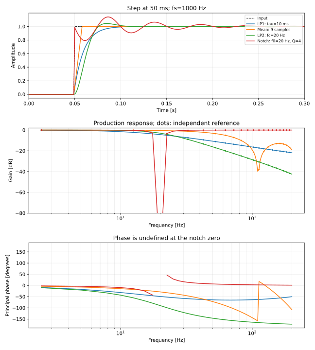

# 嵌入式固件问题定位

本文按“先稳定复现，再缩小故障范围”的顺序整理调试方法，并保留两个历史 CAN 案例。历史案例帮助理解定位过程；处理当前问题时仍要核对当前源码、任务状态和 [唯一任务清单](../../.Doc/TODO.md)。HardFault 与异常现场的概念补充见[学习笔记 13](./13-崩溃现场与异常处理入门.md)。

[toc]

只讨论运行中的bug（指程序的运行结果不符合你的期望）和异常（直接异常终止）。编译期出现的warning和error不在此范畴，他们都可以通过直接阅读报错信息解决。

## Debug方法论

**首先**，请阅读module和bsp的标准使用示例，检查你的代码和示例是否有所不同。如果你正在编写一个新的模块，务必使用**增量式编程**的方法构建你的模块，每完成一部分的功能就进行单元测试，看看是否符合你的期望。**千万不要一口气写完**，这时候再来测试，你就无从下手了。

如果确认软件没有问题，先别急着单步调试，检查一下硬件连接是否正确，包括CAN的H和L，串口的TX RX以及电源和GND。 如果你的硬件有多个相同的接口但是使用不同的功能，你得好好看看是否插错接口了。 软件中对hdevice（hcan/hspi/htim等）的设定是否和CUBEMX中配置的一致？ 模块的id和地址是否写错。

**修改之后要保存，编译，再调试/下载**。建议你把自动保存打开，并勤劳地commit。push时注意reset这些调试时产生的commit，合并成一次提交。你也可以新建一个分支用于解决bug，这是git的最佳实践。

同时注意条件编译的兼容，你是否测试一些应用或模块，却使用了错误的 `#define`？

完成上面的两步仍然无济于事，开始单步调试吧。在调试的同时，再仔细看看你的代码是否写错变量名和运算符，比如，把 `==`写成了 `=`，那么判断条件将永远是 `true`。在值得怀疑的地方，打开汇编视图，查看你要访问的地址是否正确。一步一步往下的同时，关注调用栈是否符合你的期望，添加必要的变量到调试窗口，看看他们何时发生意想不到的变化。**条件断点**是一个杀手级功能，你可以设置一些条件，让条件满足时程序在此处停下。下面的一些常见问题可能对你的调试有所帮助。

如果一切正常（或者应该说你没有发现异常，虽然他确实在那里），试着查看你使用的外设寄存器值。这时候你要用到芯片的数据手册和功能描述手册。在运行的每一步中，对照datasheet的寄存器状态和改变，看看是否符合你期望的程序行为。寄存器分为控制寄存器/状态就寄存器/数据寄存器，参照datasheet就可以明白这些寄存器是控制哪些功能，描述什么状态以及内部是什么数据。

如果你的数据是连续或规则的，记得使用Ozone可视化工具配合条件断点。

> 也可以让copilot帮帮你，选中你认为可能出错的代码，选择copilot brush-》debug

## 一些常见问题

### HardFault_Handler()

99%是由于野指针和非法内存访问导致的。在HardFault函数内添加一句 `asm("bx lr");`, 并在此处加上断点。当代码运行至此处时，选择跳出，程序会跳转回出错之前最后一句执行的语句。

查看你是否在出错前的最后一次操作中访问了非法地址或使用了已经被析构的指针。 `memcpy`的目标地址和源地址重合也可能引发硬件错误。另外，如果使用指针访问了一个非对齐地址（请参考__pack()相关的说明），这是CMSIS架构中不允许的（有些架构可以修改启动文件使其支持）；例如你有四个uint8类型的数据被存储在0x03-0x07的地址内，这时候你通过强制类型转换，以float的方式读取这四个字节，就会发生非对齐访问。 虽然结构体可以通过 `__pack(1)`来压缩，编译器会对结构体变量进行处理，在读取非对齐字段时分别读取拆分的两个部分再进行合并，从而支持非对齐访问；但前述的行为却是未定义的，编译器在编译代码的时候并不知道你会以分开的方式访问这段内存，即使知道，他也无法预测栈上分配的空间是否能对齐。

常见的错误还包括使用未初始化的指针（内部可能时垃圾值，指向未知的地址）和初始化为NULL的指针（指向0x00地址）。`free`一个指针两次也可能导致错误。

### 通信外设传递的数据没有进行压缩

经典的 `__pack()`问题。这种问题大多出现在结构体的传输上。用于通信的结构体请在两端用 `#pragma __pack(1)`和 `#pragma __pack()`包裹。否则传输时会出现空字节，使得数据和你使用的协议对不上号。

### Delay或定时器卡死永远不跳出

Systick和HAL_Delay以及使用TIM来定时的方法，都需要通过**中断**来更新时间。如其重装载计数器上限为65535，当计数达到此值时会触发中断，在中断处理函数中，增加一次溢出的时间。如果此时有更高优先级的中断或同优先级的中断正在运行，且他们耗时很长 or 调用了这些依赖中断的Delay函数，那么将会形成**死锁**，永不见天日。 如果中断被关闭，这些计时也无法更新。 这里推荐使用DWT定时器（在 `bsp_dwt`中实现），其重载计数器是64位的，按照stm32f407 168MHz的运行频率，需要两天多的时间才会发生溢出，因此仅依赖其重载计数器，计算两次tick的差值就可以实现高精度的定时（除非你delay超过两天，你在搞笑）。

### 静态变量的陷阱

注意，函数内的静态变量只会在程序启动的时候初始化一次，之后不论多少次重入，都会保存上一次修改的值。

然而，如果静态变量被放在头文件里，则每个包含该头文件的其他源文件，都会拥有一份自己的备份，这些备份之间是互不影响的（详见编译期的头文件展开）。 千万不要认为静态变量是全局的，它只是在当前文件内有效。

### 指针越界读写/内存泄漏

有时候，你发现你使用的变量值变成了奇怪的数，或者你的程序突然崩溃了，但是你并没有在代码中对这个变量进行过修改。这时候，你应该检查一下你的指针是否越界了。 你也许没有正确的将void\*指针cast成期望的类型，使其访问了不该访问的位置；例如，一个uint8类型长度为4数组，你希望将其转化为float进行读取。但你在声明数组时只分配了3个字节，使用float\*访问就会触及未知的第四个字节，第四个位置上存放的可能是其他变量的值，这时候访问其他变量就会出现奇怪的值。 或者，你在 `memset()`和 `memcpy()`的时候没有正确设置源地址和目标地址或长度。

### 实时系统

中断中使用实时系统的接口时记得使用有 `ISR`后缀的版本，它们对中断的调用做了特殊处理。所有中断的优先级都是高于RTOS中任务的优先级的。

若期望某个任务以1KHz频率运行，你可能会在任务循环外加一个 `OS_Delay(1)`，但是你的任务执行时间要是超过了1ms，系统的调度就会出现异常，倘若你还在此任务内认为每次进入的时间间隔是1ms并据此编写了一些依赖周期性的代码，那便是大错特错了。

对于实时性和周期性要求高的任务，使用 `vTaskDelayUntil()`，这可以获得更高的定时精度。

不同的任务/中断调用了相同的函数，或使用了共享变量/全局变量/函数内的static变量会导致读\&写冲突，也被称作**数据竞争**。这一般只会在任务繁重且中断频率高时出现。要避免这种情况，访问共享变量时应进入临界区（关闭全局中断）或使用**互斥锁**。消息队列也是一个不错的选择，这些功能在FreeRTOS中都提供了支持。

### 中断

中断不要放入太复杂的逻辑和运算。使用标志位或将要处理的数据转移到队列中，于任务中检查标志位，判断是否要进行数据的处理。否则可能出现中断过于复杂/频繁使得通信出现overrun error

强烈建议初始化时不要使用和中断相关的功能，若你在中断过程中访问了一些尚未初始化的变量，就很大概率会出现前述的野指针/越界等问题。 非要使用，请添加一个标志位，并让中断判断初始化是否完成。**当前框架在初始化机器人的时候关闭了全局中断，所以千万不要使用中断和与symstick/HALtick有关的延时！**

### 强制类型转换

long long的范围比float小。无符号和有符号数直接转换可能变成负数。**应该在一切可能表达运算顺序错误的地方加上括号以明确操作的顺序，即使你知道不同运算符的优先级。** 使用移位操作要注意你的变量类型，请不要相信编译器的临时变量生成，务必加上类型转换。

例如：`#define MY_MACRO_NUMBER 3.0f`，使用宏定义一些带小数点的数据时记得加上.0或f后缀，干脆两个都加。无符号定义要加u后缀。

### 宏

换行用 `\` ，注意同一个代码块展开后用花括号 `{}`包裹，特别注意宏展开之后是直接的文本替换！！！

用已有的宏定义宏并且进行运算时，要将后面的字段用括号包围，因为：

```c
#define YOUR_DEF SOMETHING 
// 宏通过空格来解析替换字段,YOUR_DEF空格后的第一个字段当作替换文本
```

**宏只在当前文件生效**，如果宏放在.c那么对其他的文件是不可见的，这也一般称作私有宏。

## 典型debug案例一

这是一个结合了软件和硬件且有多模块耦合的异常。该bug发生在调试平衡步兵的底盘过程当中。

### 引发bug的原因

1. 指针在强制类型转换中变成了错误的类型,使得指向的内存地址被错误地修改
2. CAN总线负载过大导致电机反馈消息丢失

这里是发生bug的代码片段:

```c
static void LKMotorDecode(CANInstance *_instance)
{
    static LKMotor_Measure_t *measure;
    static uint8_t *rx_buff;
    rx_buff = _instance->rx_buff;
    measure = &((LKMotorInstance *)_instance)->measure; // 通过caninstance保存的id获取对应的motorinstance
	// 上面一行应为: measure = &(((LKMotorInstance *)_instance->id)->measure); 
    measure->last_ecd = measure->ecd;
    measure->ecd = ...
  
    // ....
      
}
```

这是问题1的出处。can instance中保存了父指针，即拥有该instance的LKMotorInstance。这里想通过强制类型转换将 `void*`类型的 `id`转换成电机的instance指针类型并访问其measure成员变量以从CAN反馈的报文中更新量测值。然而却直接将can instance转换成motor instance。

随后，更新之后的数据被覆写到can instance内部，使得其成员变量改变，包括hcan、txbuf、rxbuf、tx/rxlen等。hcan是HAL定义的can句柄类型，里面保存了指向can状态和控制寄存器的指针以及其他HAL状态信息，然而其值被电机反馈回来的值覆写，之后HAL的接口访问hcan时将引起异常。

第二个问题则不是显式存在的：

```c
void MotorControlTask()
{
    DJIMotorControl();

    HTMotorControl();
  
    LKMotorControl();

    ServeoMotorControl();

    StepMotorControl();
}
```

这是motortask的内容，此任务将以500hz的频率运行。在发生bug时，我们将4个HT04电机和2个LK MF9025电机全部连接到CAN1上。注意，HT04不支持多电机指令，因此占用的带宽较大。在 `LKMotorControl()`完成参考值计算和CAN发送之后立刻会调用 `HTMotorControl()`，后者需要连续发送4条报文。而HT和LK电机都会在接收到控制指令之后发送反馈信息报文。由于HT电机的控制在LK电机控制之后立刻执行，导致总线被占据，LK电机发送的反馈数据仲裁失败无法获得总线占有权，使得主机收不到反馈数据。

### bug的发现和定位的尝试

程序的大体情况如下，当时进行轮足式倒立摆机器人的测试，启用了balance.c，在其中注册了4个HT04电机（can1）和2个LK9025电机（can2）。控制报文的发送频率均为500Hz。

测试时发现，9025电机可以接收到mcu发送的控制指令并响应，但是mcu始终无法获得反馈值，`LKMotorInstance->measure`的所有成员变量一直是零。由于CAN是总线架构，电机能接收到数据说明通信正常。HT04电机也可以正常控制并收到反馈信息。在 `LKMotorDecode()`函数中添加断点发现能够成功进入1~2次，随后便引发HardFault。

此时内心有些动摇，开始检查硬件连线。我们尝试把LK电机也挂载到CAN1总线上。开始单步调试，发现LK电机可以正常接收一次反馈报文，之后就进入 `Hardfault_handler()`。HT和DJI电机均无此问题。进一步进行每条指令的调试，发现在成功接收到一次报文之后（接收报文指的是can发生中断并在处理函数中调用LK电机的解码函数，我们并没有查看measure值是否刷新，实际上这时候反馈值仍然为零），进入该电机的控制报文发送时，通过在 `Hardfault_handler()`中添加汇编语句 `asm("bx lr")`，即跳转到最后一次执行的指令，发现访问 `hcan->state`会引起硬件错误。遇到这种情况，说明发生了越界访问或使用了野指针。检查hcan的值，发现是一个非常大的地址。因此怀疑hcan指针被其他的内存访问语句修改。

有了方向之后，进一步对每一个函数都进行单步进入调试，同时时刻监测hcan1的值。然而，这时候出现即使一开始就单步调试也无法进入LK电机解码函数的问题。于是，怀疑是CAN过滤器的配置问题，使得LK电机反馈报文被过滤，检查LK的接收id无误后，认为可能由于LK电机的发送和接收ID都比较大（0x140和0x280），CAN标准ID放不下。但是查阅CAN specification后发现standar ID可以容纳11位的值，应该不会有问题。于是把过滤器配置为mask模式，让bxCAN控制器接收所有报文（即不进行过滤）。然而还是不奏效，仍然无法收到数据。

这时候想起HT电机是不支持多电机控制指令的，因此500Hz的控制频率似乎有些过高，相当于2ms内要完成2x4+1+2=11次CAN报文的发送。计算1M波特率下最大通信速率，果然超出了负载。于是降低 `MotorTask()`的频率为200Hz，果然能重新接收到数据了。

继续单步调试，终于发现在 `LKMotorDecode()`中，通过强制类型转换获取LKMotorInstance的时候，用错了变量，使得反馈值被写入电机的 `CANInstance`内，导致hcan指向随机的地址，最终造成访问时引发hardfault。

修改之后，将LK电机挂载到CAN2上，控制频率回到500Hz，程序正常运行。

### 解决方案

均衡总线负载，调节任务运行时间。

# 典型debug案例二

这仍然是一个CAN总线引发的bug。使用的电机均为DJI电机。当多个电机接入时，会产生反馈值跳变的情况。起初认为**总线负载过高**，（控制频率为500Hz，反馈频率均为1kHz，计算之后得出CAN的负载率接近90%），但将电机减少为一半甚至更少时仍然出现此问题。**单独使用CAN1且仅挂载一个电机则问题消失**，同时使用CAN1和CAN2（不论单个总线挂载几个电机）则问题再次出现。

**单步调试发现反馈值并未因指针越界而被纂改**。仔细检查代码的计算发现并未出错，打开Ozone查看反馈值曲线，发现确实偶发跳变，但跳变值并未超出反馈值范围，即即使发生跳变值仍然在**正常范围内**，因此不像是总线负载过大导致数据帧错误或指针越界修改的随机值。加入多个电机同时查看反馈值，**发现反馈跳变之后会和另一电机的反馈值相同**，呈现“你跳到我我跳到你”的图景。怀疑CAN中断被**重入**，即一个中断未完成时另一个CAN报文到来，打断了当前的中断并执行了**相同的反馈解码函数**。但CAN1和CAN2的中断优先级均为5，因此不可能打断彼此。打开CubeMX查看初始化配置，发现两个CAN的FIFO0和FIFO1中断优先级不同，分别是5和6。则FIFO1的溢出中断会被FIFO0打断，且我们在电机的解码函数中使用了一些**静态变量**用于存储触发接收中断的电机报文的相关信息，故而新进入的中断覆写了之前中断的静态变量值，使得之前中断在恢复之后存储了前者的值，导致自身反馈错误。

将优先级统一设为5，编译之后重新运行，反馈值正常。

> “同时使用CAN1和CAN2（不论几个电机）则问题再次出现。” 导致此问题的原因是初始化CAN时按照rxid分配FIFO，因此注册的电机会被交替分配到不同的FIFO，故不论注册了几个电机（只要多于2）、注册到哪条总线都会出现FIFO1中断被FIFO0打断的情况。


## MC02-0045：复位后的 dummy read 与有界初始化写入

BMI088 加速度计启动时先通过 SPI 访问完成接口切换。软复位后，第一次读取要丢弃；这笔事务让器件退出复位过渡状态，不能把返回字节当成芯片 ID。驱动再读取 chip ID，并要求值为 0x1e。陀螺仪单独检查 0x0f。流程依据 Bosch 官方 BMI08x SensorAPI 的加速度计初始化实现：[bmi08a.c](https://github.com/boschsensortec/BMI08x_SensorAPI/blob/master/bmi08a.c)。

HAL_OK 只表示 MCU 的 SPI API 报告事务完成，不能证明预期的从器件正确应答。芯片 ID 是另一层检查：传输成功但 ID 错误时，初始化仍然失败。ERROR、BUSY、TIMEOUT 表示事务未完成，当前传感器初始化尝试立即结束，再由有限重试策略决定是否重新开始。

回归测试通过生产入口 BMI088Register() 验证。主机夹具模拟软复位前后状态变化：复位后的第一次读取返回无效值，下一次读取返回正确 ID。它检查调用顺序和错误传播，而不只是固定寄存器值的比较。

只读运行诊断命令：

    python3 tools/probe_snapshot_live.py --imu --elf build/wsl-0035-bench-safe/Basic_Framework_MC02_bench_safe.elf --samples 5 --interval 1

--imu 配置只解析固定的 32 位诊断符号：初始化阶段与失败阶段、HAL 状态、芯片 ID、有效样本序号和时间、INS 有效标志、加热占空比。GDB 只离线解析 ELF 符号；OpenOCD 通过本机 loopback 连接，只读取白名单地址，并在读取前后确认目标处于 running。工具不发送停核、复位或继续运行命令。初始化阶段数值定义在 modules/BMI088/bmi088.h 的 BMI088_Init_Stage_e 中。

这些软件观察能说明驱动收到的字节与状态，不能测出传感器供电轨、片选、电平或 SPI 波形。没有万用表和逻辑分析仪时，物理链路仍待测量。

### 裸板实测与证据边界

2026-10-08，在 12.5 V、2 A 限流供电下，烧录后的启动快照、三次 MCU 复位快照和后来一次两路断电后的真实冷启动快照，均读到加速度计 `0x1e`、陀螺仪 `0x0f`、READY、有效样本和零加热占空比。601 秒监测中系统 tick 与样本序号持续增长，IWDG 复位标志、CRC 错误数保持为零。这能证明当前接线和当前板卡上驱动持续拿到了有效样本；它不能单独证明传感器电气时序或供电裕量。

串口状态帧也提供独立交叉检查：首次 5 秒收到 1,018 个、冷启动后 5 秒收到 1,017 个 CRC 正确的 43 字节帧，两次四元数均为有限数且范数约为 1。两次记录的平均姿态角差约 5.9°，但冷启动时没有受控记录板姿态，因此这个差异不能证明跟随姿态变化。静置时看到的微小变化也可能来自噪声或积分漂移；只有在已知姿态下轻缓改变板姿态，并比较前后四元数，才能验证姿态响应。USB 与主输入同时断开的冷启动必须真实断开两路供电后再测，软件 `reset run` 不能代替冷启动；本次已完成该冷启动。

### 受控动作如何验证姿态响应

验证姿态响应需要同时记录输入动作和输出变化。MC02-0045 的补充验收先记录静置，再轻缓抬起一侧并保持，最后放回同一位置；三个阶段各取稳定的 5 秒窗口。倾斜和放回由用户确认，确认后先等 3 秒再统计，避开手持转换时的抖动。COM14 全程只接收，原始字节、接收时间和阶段标记一起保存，便于回查动作发生在何时、数值是否对应变化。

本工程四元数以 `(w,x,y,z)` 保存，在 [SP 状态帧](../../modules/master_machine/vision_protocol.h) 中位于偏移 3 的四个小端 `float`。四元数用四个数表示三维旋转，正常范数应接近 1；本板输出约为 `0.998314`。分析时先检查每项都是有限数、原始范数处于约定范围，再除以范数。不能先归一化再宣称原始数据健康，否则异常大小的数也可能被处理成单位四元数。

`q` 与 `-q` 表示相同旋转，逐项看正负号或者直接相减容易误判。若比较完整姿态，可以用归一化四元数点积的绝对值计算夹角。但本次动作只改变板子倾斜程度，完整姿态差还会混入偏航变化。当前 BMI088 提供加速度和角速度；[INS 实现](../../modules/imu/ins_task.c) 用重力约束倾斜方向，偏航仍可能出现积分漂移，因此这里比较的是重力在板坐标系中的方向。

按照生产 `EarthFrameToBodyFrame()` 的约定，把地球坐标系的单位重力方向 `(0,0,1)` 转到板坐标系。归一化后的四元数给出：

```text
g_x = 2 × (x × z − w × y)
g_y = 2 × (y × z + w × x)
g_z = 1 − 2 × (x² + y²)
```

再对每个稳定窗口的重力方向求平均并归一化，用两个平均方向的点积计算夹角。计算 `acos` 前把点积夹在 `[-1,1]`，避免浮点舍入把本应为 1 的数算成略大于 1，产生 NaN。绕重力方向旋转不会改变该方向，这使倾斜验证减少了偏航漂移的干扰；它同时也意味着本次实验没有验收绕竖直轴旋转的响应。

方向波动 **P95** 表示：至少 95% 的样本与该窗口平均方向的夹角不超过这个值。它检查“保持不动”阶段是否稳定；只看平均值可能掩盖来回摆动。验收要求每窗口至少 100 帧、P95 不超过 3°、倾斜响应至少 5°、放回差不超过 5°。

2026-10-08 实测三个窗口各有 1,000 帧，倾斜时方向变化 `21.154°`，放回差 `0.253°`，三个 P95 分别为 `0.073°／0.602°／0.016°`。全程 12,775 个完整状态帧 CRC 正确，四元数全部有限；前后只读快照均显示有效样本持续更新、加热占空比为零、IWDG 标志为零。这补齐了受控动作响应的证据，完整阶段、固件 SHA 和原始数据哈希见 [MC02-0045 票据](../workflow/tickets/MC02-0045.md#2026-10-08-受控姿态响应验收)。

这里的 `21.154°` 是算法输出的角度，没有独立角度仪表来核对真实倾角，所以结果只说明倾斜与放回具有对应响应，不能据此宣称角度精度合格。只读寄存器和串口数据也没有测出电源轨、SPI 波形、加热引脚实际电平或 VIN 精度；这些仍需要受控供电和测量工具。写出这些解释不代表读者已掌握，本次不新增掌握记录。

## LCD 阶段完成但屏幕仍黑：先让故障现场说话（MC02-0046）

用户报告启动黑屏，按键后才有概率恢复，恢复后可能乱码或翻转。第一次只读快照是在恢复后采到的：任务心跳与刷新周期都在增长，初始化耗时约 0.56 秒。它无法说明启动黑屏时发生了什么，因而需要一次受控复现。

本次用户准备观察，代理仅复位 MCU 一次，随后保持不按键、不动线缆。前 10 秒用户确认“仍黑屏”；40 组运行态快照中，初始化从阶段 1 到 6，记录耗时 559700us，刷新继续执行、恢复计数为零、加热占空比为零。这让排查范围缩小：本次黑屏存在于任务正常运行期间，不是单凭黑屏就认定系统卡死或看门狗循环复位。原始材料与复现命令见 [MC02-0046 票据](../workflow/tickets/MC02-0046.md)。

`lcd_init_stage=6` 是软件走到了初始化末尾；面板没有应答确认这句话。现有 `lcd_spi_errors` 在 [lcd_buf.c](../../modules/lcd/lcd_buf.c) 中仅统计行数据的 HAL 错误，而 [lcd.c](../../modules/lcd/lcd.c) 的命令发送忽略 HAL 返回值。因此“阶段完成”和“错误计数为零”都不能替代物理显示观察。与 BMI088 的 HAL_OK 一样，HAL 层报告成功也不证明外设按预期解释了字节。

### 采样边沿和数据变化边沿要分开

当前 SPI1 配置为 CPOL=HIGH、CPHA=1EDGE。空闲时钟高时，第一条边沿是下降沿：MCU 在该边沿采样，在随后的上升沿推进发送数据。LCD 驱动采用的 [ST7789V2 数据手册 §8.4.2](https://files.waveshare.com/wiki/common/ST7789V2.pdf) 规定面板在 SCL 上升沿锁存输入；§7.4.3 给出建立与保持时间要求。于是面板锁存的时刻恰好可能是发送端换数据的时刻。

“建立时间”指锁存边沿之前数据需要保持稳定多久，“保持时间”指锁存之后还要稳定多久。若两个动作挤在同一边沿，即便 HAL 成功发出了 8 个时钟，外设也可能读错位。这是明确的配置问题；要把它认定为这块板子黑屏的根因，还需要一次只改相位、保持分频和延时的对照验收。没有波形测量时，主机边沿模型只能证明配置符合协议，不证明真实引脚的建立时间裕量。

乱码、意外方向改变和黑屏可以来自不同阶段，不能一次同时改相位、降频、换延时、加自动重初始化后就宣布找到了原因。先复现，给每条假设写出可观察预测，每次只改一个变量，再重新执行同一启动步骤。当前电流约 0.11A 后回落至约 0.09A 的记录没有支路测量，仍只是一条观察，不作为因果解释。

### 生产接口的边沿回归能证明什么

[lcd_spi_timing_test.c](../../tests/host/lcd_spi_timing_test.c) 联编生产 `MX_SPI1_Init()` 和 `LCD_Init()`，只替代 HAL/GPIO 硬件边界。接收模型按数据手册固定在上升沿锁存，发送模型根据生产配置推进时钟与发送边沿；测试检查锁存与换数据是否共用边沿，并检查实际初始化流发出了 sleep-out `0x11`、display-on `0x29` 且正确选中面板。原配置测试失败，报告 464 次可能重合的发送边沿；这是一段初始化流的模型统计，不是实测波形。

首轮只将 SPI1 相位从 `1EDGE` 改为 `2EDGE`，空闲高时钟与分频 4 均保留，因而使用 Mode 3，在下降沿推进发送数据、上升沿给面板锁存。修复后初始化与重复初始化测试均通过，Mode 0 这种同样把数据变化放在下降沿的合法配置也不会被模型拒绝。CubeMX 的 `.ioc` 同步登记相位，防止重新生成代码时丢掉修正。

主机测试保护的是“按面板协议配置时序”，不具备面板、电缆、实际 SCK 频率或电源轨。板上必须重新执行“启动、不按键、观察首帧显示”的步骤；如果仍黑屏，说明至少还有其他原因，不能因模型变绿就关闭 MC02-0046。模型也没有解决命令发送错误未传播、长超时和物理按键抖动；这些仍按实际诊断证据推进。

### 对照未消除症状，就继续缩小假设

`ced1987` 相位修正版本烧录与参数保留成功，60 秒通信、IMU 和禁热隔离检查通过，但用户仍看到启动黑屏、按键后才有概率恢复。这否定了“只改相位即可消除黑屏”的预测。协议配置修正有自身依据，实物问题却没有因此通过验收；应如实保留两条结论。

下一处边界出现在片选与 SPI 启停之间：[LCD_Writ_Bus()](../../modules/lcd/lcd.c) 先选中面板，再调用 HAL；[HAL_SPI_Transmit()/SPI_CloseTransfer()](../../Drivers/STM32H7xx_HAL_Driver/Src/stm32h7xx_hal_spi.c) 在事务内启用/关闭 SPI。除了 8 个数据时钟，选中面板到第一位数据之前的任何额外上升沿也会被计入。仅保证数据时钟内部的相位正确，还没有检查这段边界。

原 `MasterKeepIOState=DISABLE`，其选项通过 `CFG2.AFCNTR` 控制复用 GPIO。在主机发送模型中，注入“SPI 未控制 IO 时 SCK 为低”，启用空闲高 SPI 就可能在片选有效时制造额外上升沿。原配置的初始化流模型得到 58 次额外边沿；开启 IO 保持后，低/高两个注入情况都通过。第二候选仅开启该选项并同步 CubeMX，频率和延时仍不改。该数字仍是模型统计，实际板上有没有这条边沿需要波形或受控启动对照验证。

本轮额外 LCD 快照的 running 响应检查失败，保存日志并终止探针会话，后续候选尚未烧录。两个采集器曾同时使用一个探针，下一轮应先串行读取，以排除观察工具干扰。缺失状态行不等于证实芯片停核；同样，另一份自动回归通过也不能替这次失败快照补出缺失的 LCD 状态。

### 先验证观察链路，再比较候选固件

2026-10-10 将 LCD、IMU 和隔离寄存器读取合并为一次性串行采集，保留 socket 原始收发日志。首次 `targets` 响应中的 `mc02.cpu0` 状态明确为 `unknown`，采集器在任何内存读取之前退出，尚未烧录 IO 保持候选 `1b668dd`。OpenOCD 同时报告 target examination 成功：这只证明调试器识别并检查了目标，不能替代后续运行状态确认。原始响应及哈希见 [本轮记录](../workflow/tickets/MC02-0046.md#2026-10-10执行串行采集前置检查目标状态-unknown-后停止)。

`unknown` 表示这次响应没有给出可使用的运行状态。它不是 `halted`，也不能当作 `running`。工具要先确认 running，随后才读白名单中的单值内存，并在每次读后再次确认。如果把 unknown 直接当作运行正常，就失去了“未对正在停核的芯片做验收”的保证。当前也没有证据证明芯片已经故障或 LCD 改动造成了问题。

原始字节记录比只留最后一行异常更有用：这次可以证明收到了完整的状态表，可以区分“响应缺行”“解析失败”和“目标明确报告 unknown”。Telnet 开头包含协商控制字节，因此保存为十六进制并在离线解释时保留字节顺序；不要把这些字节当作屏幕乱码。运行日志、字段解释和现场 LCD 观察是不同证据，各自保留。

单客户端仍出现 unknown，也说明“并行访问探针”不足以解释所有读取失败。服务刚开始接受连接时，是否已经完成首次目标状态轮询，是下一轮可以单独验证的观察条件；本轮没有做该对照，因此只保留假设。遵守读取失败即停止的约定，比立即重连后只保存成功结果更有助于复盘：原始失败不会被后续成功覆盖，候选固件的显示结果也不会与观察工具问题混在一起。

后续显示验收仍由不按键启动、普通翻页和明确长按恢复三个场景组成。普通翻页允许局部重画，不能出现整屏黑场；长按中键明确请求面板重新初始化，短暂黑场符合该操作语义。对比恢复计数可以检验普通翻页是否意外走到了恢复路径，但仍需现场画面证据，不能只凭计数宣布屏幕正常。本次仅更新解释，不记录读者已掌握。

### 调试工具超时与芯片故障要分别记录

用户重新确认硬件条件后，本次采集器在 OpenOCD 开始监听后固定等待 1 秒，再做首次 running 检查。得到 3 组完整快照，IMU 样本递增，禁热与隔离寄存器正常。此前首次连接得到 unknown，这次得到了 running；两次结果提示服务启动时机可能影响观察，但没有建立重复的对照，不能把固定等待称为已证明的根因修复，也不能据此关闭 LCD 任务。

下一步的整片 Flash 备份被宿主脚本的 45 秒总时限中断，文件只有 921600 字节，目标应为 1048576 字节。`1MiB` 是 1024×1024 字节；文件名写着 1MiB 不意味着文件已经完整。哈希也只标识文件实际内容：不完整文件同样可以计算 SHA-256，不能用“有哈希”代替长度检查。烧录前应同时检查完整长度、参数备份长度、参数与整片对应切片的一致性，再进入写入流程。

这次超时来自 agent 设置的宿主等待时限，不能据此断言芯片失联。运行脚本杀死 OpenOCD 也不等于芯片恢复运行：备份命令在读取前请求 halt，而末尾的 resume 没有完成证据，因此只能记录运行状态未确认。对需要停核的维护操作，应明确确认 halt 已完成，并为完整备份留出足够时间；失败后的目标状态不能用成功前的快照补齐。

下一独立尝试已离线调整为 120 秒备份时限、先 poll 再 halt 并 wait_halt，且使用新文件名保留失败证据。它尚未重新上板执行。延长维护操作时限和放宽状态判定是不同改动：前者为大文件读取提供时间，后者会让未知状态冒充成功，本次保持状态判定严格。详见 [本轮备份记录](../workflow/tickets/MC02-0046.md#2026-10-10-retry1串行检查通过完整备份超时尚未烧录)。

### IO 保持候选首次恢复显示：从模型走到受控对照

用户重新要求执行后，retry2 用 120 秒备份窗口和明确停核确认完成整片与参数备份，随后成功烧录、verify 并比较参数。IO 保持候选 `1b668dd` 启动后，用户确认无需按键即可自行显示并持续刷新。前一个只改相位的 `ced1987` 仍黑屏，两者之间的固件差异仅为 IO 保持及其 CubeMX 记录，因此这次结果支持该配置对当前接线下显示可靠性的改善；具体电气波形与唯一根因仍没有测量证据。

SPI 相位规定每一位在什么边沿改变和采样；IO 保持规定 SPI 关闭时谁继续控制这些引脚。一次字节传输完成后，HAL 关闭 SPI，下一笔事务又重新启用。若这段边界上出现额外采样边沿，面板可能把后续字节解释到错误的位置。主机注入模型覆盖这条边界；实板“不按键启动”则检查完整链路的可见结果。模型测试、运行配置字段和物理显示观察一起构成证据，三者不能相互代替。

本次 60.442 秒回归取得 12087 个 CRC 正确且四元数有限的状态帧，中性指令准确发送并解析 1000 帧、停发后清零，LCD 恢复计数没有增加。它说明改动后的启动、采样、通信和禁热隔离在该窗口仍正常，尚不能代替冷启动、翻页和长时间观察。三次独立 MCU 复位的自动快照与人工显示确认均通过；后续十分钟及翻页记录仍有未达成的条件，见下节。完整证据见 [retry2 记录](../workflow/tickets/MC02-0046.md#2026-10-10-retry2完整备份烧录校验与参数保留通过)。

参数回读采用移除了默认调试冻结写入的只读配置，确认 running 后读取 Flash。备份需要停核，运行态回归需要保持运行，维护动作和观察动作各自有明确边界；不能用烧录配置的隐含行为来改变十分钟运行窗口。PB1 等寄存器仍只是配置与锁存值，不是实际引脚波形。这里记录工程验证，不新增读者掌握记录。

### 显示正常与恢复计数增长可以同时出现

MC02-0046 后续 600.451 秒窗口收到 120085 个正确状态帧，IMU 有效递增、禁热和输出隔离正常；用户完成二十次普通翻页并反馈显示正常。然而 `lcd_recover_count` 从 0 增至 21。画面观察回答“人是否看到了异常”，计数回答“程序是否走过恢复流程”，两者测量的是不同事实，均应保留。自动报告的 `passed=true` 只覆盖脚本实际检查的项目，不能扩展为整份验收清单通过。

现有 [LCD 任务](../../modules/lcd/lcd_task.c) 包含在位检测和按键主动恢复等路径，恢复计数没有逐次记录触发来源。每 30 秒一份快照能证明计数发生变化，却看不到中间每次 ADC 采样、线缆瞬态或按钮动作。仅凭计数无法区分接线问题、采样问题与软件判定过敏；行发送 HAL 成功也不证明屏幕接受了所有命令。因此“可能涉及硬件”仍是待查证的解释，不能写成已测定的故障原因。

### 关闭任务时保留哪些结论

用户决定停止 MC02-0046 的软件排查，后续自行更换硬件查证。按仓库规则，TODO 用 `[x] [wontfix]` 加原因表达这一决定；启动和通信已通过的结果继续保留，恢复计数条件未满足、冷启动和长按测试未执行也继续保留。已验证的 IO 保持改动留在固件中，未完成验证的在位检测试改撤回。这让以后重新查看记录时能区分“已验证的改动”“未证实的解释”和“本次选择停止的工作”。

更换硬件是一种对照：若以后用相同固件、相同供电和相同操作步骤，只更换 LCD 或线缆，就能比较故障频率及恢复计数是否变化；一次同时换屏幕、线缆和软件只能说明组合结果改变，难以定位具体因素。即便新硬件表现正常，也应记录更换对象和复现次数，再界定结论的适用范围。本次仅整理已有证据，不表示已完成该对照，也不记录读者已经掌握这些概念。

### 设备驱动的帧长度和缓冲区大小要一起核对（MC02-0123）

看通信代码时，把设备要求的长度、接收缓冲区容量和函数传入的长度放在一起检查。当前 `TFMiniPlusGetDistance()` 向 IIC 请求 11 字节，但对象里的 `buf` 只有 9 字节；注释已标出这处越界风险，调用会写出数组范围，后续使用前需要修正实现。这里记录的是当前代码问题，注释没有替代修复。

HC05 驱动按帧头、4 字节数据和帧尾处理数据，`HC05_Send()` 也要求传入 4 字节；长度不符时，发送数据和帧尾的位置可能对不上。Daemon 的计数器则在任务每次运行时递减，当前任务约每 10 ms 运行一次，所以计数表示任务调用次数；若把它直接当毫秒使用，必须结合任务周期换算。

## 滤波器的输入和结果由谁保存（MC02-0078、MC02-0099）

[kalman_filter.h](../../modules/algorithm/kalman_filter.h)现在提供查询、初始化、重置、更新和复制结果五个入口。调用者保存`KalmanFilter_t`和独立工作区，先用`KFGetWorkspaceRequirements()`取得字节数及地址对齐要求，再调用`KFInit()`。INS使用`_Alignas(KF_WORKSPACE_ALIGNMENT) uint8_t workspace[KF_WORKSPACE_BYTES(6,0,3)]`静态声明。工作区与实例一样长期存活，不能与实例、初始数组或其他实例的工作区重叠；初始化和更新都不申请内存。

状态数及最大量测数为1～255，控制输入数为0～255；量测数可以大于状态数。初始化后填写F、B、H、Q、R，再传入`KFStep_t`。`measurement_present`为显式存在标记，合法零值会参与校正；实际量测数为0表示本轮缺样。dt由调用方实测，以秒传入，毫秒时刻和量测源序号也由调用方传入。算法不读取HAL、DWT或RTOS时钟，预测不会刷新上次成功校正的源时刻。

更新后先检查返回状态，再通过`KFGetState()`复制数值和`KFResult_t`。复制成功只表示读到了结果，使用前仍须看`valid`：

| 结果 | 含义和处理 |
|---|---|
| `KF_OK`／`KF_CORRECTED` | 本轮新鲜量测校正成功，更新方差基准和量测源时刻 |
| `KF_PREDICTED`／`KF_PREDICTION` | 预测成功、校正未成功；仍在调用方设置的时间及方差范围内 |
| 负数／`KF_INVALID` | 有效标记已撤销，数值保留最后有效结果供诊断；不得继续发有效姿态 |

当前IMU要求至少成功校正一次后才允许纯预测。距上次成功校正的**源时刻不超过20ms**，并且每个状态的预测方差都不超过其上次成功校正值的**2倍**；两个边界均允许。零方差基准不额外放宽，新陀螺仪样本不能延长校正期限。某一个状态超限就失效，基准不能随每轮预测一起增大。这是软件默认配置，不保证实际姿态精度。

20ms限制的是缺少成功校正时还能使用预测多久。它不额外限制IMU可计算的dt：例如任务延迟25ms后拿到一份新鲜合法量测，只要预测和校正正常，就允许恢复；如果这时仍无量测，则撤销输出有效性。实际IMU默认接受有限正dt，计算中出现溢出等错误才进入严重预测失败。原始样本失效期间累计真实间隔，恢复后不能假装只过去了1ms。[生产INS测试](../../tests/host/ins_filter_test.c)同时检查25ms延迟、新校正恢复及数值失败后继续无效，避免把两种情况混在一起。

超时或方差超限时，内部正常预测继续推进，新鲜合法量测校正成功可以恢复。预测计算失败则锁定无效，须显式`KFReset()`或重新初始化；新的合法输入不会自动重建姿态参考。重置接受新的初始状态与协方差，清计算和时间历史，保留工作区归属及模型配置。

[QuaternionEKF](../../modules/algorithm/QuaternionEKF.h)沿用原有公式和增益，自定义步骤只写候选数组并返回状态。无效加速度表示本轮缺量测，不再补成重力方向；被拒绝的方向也不会因累计次数超过50而强制校正。INS在原始样本失效或滤波无效时撤销IMU许可、把状态帧模式和姿态输出归零，不修改SP帧布局。数值测试、回调／矩阵失败注入和生产INS测试见[任务详情](../workflow/tickets/MC02-0099.md)。

扩展步骤返回`KF_OK`表示该步骤成功，负数表示失败。`KF_PREDICTED`由完整更新入口在发布有效预测后给出，回调不能拿它表示自己成功或跳过校正；误返回正数会转成`KF_ERROR_STATE`。这样，更新入口的“仅预测”返回值与结果中的有效标记才能保持一致。

## RLS 参数估计的工作区与失败处理（MC02-0080）

[RLS.h](../../modules/algorithm/RLS.h) 的新接口由调用者保存实例和工作区。先清零 `RLS_t`，用 `RLSGetWorkspaceRequirements()` 查询容量和对齐，再调用 `RLSInit()`；每个实例需要独占一块工作区。`RLS_WORKSPACE_CAPACITY(n)` 可用于静态声明，数组首地址仍须满足查询的对齐要求。初始化和更新不申请堆内存。

```c
static RLS_t power_rls = {0};
static _Alignas(RLS_WORKSPACE_ALIGNMENT)
    uint8_t power_rls_workspace[RLS_WORKSPACE_CAPACITY(2U)];
static const RLSConfig_t power_rls_config = {2U, 1.0e-5f, 0.99999f};
static const float initial_params[2] = {100.2f, 1.2f};
size_t workspace_bytes;
size_t workspace_alignment;

if (RLSGetWorkspaceRequirements(2U, &workspace_bytes,
                                &workspace_alignment) == RLS_STATUS_OK &&
    workspace_alignment == RLS_WORKSPACE_ALIGNMENT &&
    workspace_bytes <= sizeof(power_rls_workspace) &&
    RLSInit(&power_rls, &power_rls_config, initial_params, 2U,
            power_rls_workspace, workspace_bytes) == RLS_STATUS_OK)
{
    /* 后续才可提交恰好2个输入值的样本。 */
}
```

每组输入 `x` 和实测输出 `y` 必须恰好匹配维度且为有限值；零值是合法样本。`delta` 必须大于0，`lambda` 位于(0,1]。不同实例可并行使用，每个实例由调用者串行访问。递推关系为 `d=lambda+xᵀPx`、`K=Px/d`、`e=y-xᵀtheta`、`theta_new=theta+Ke`、`P_new=(P-KxᵀP)/lambda`。K 单独保留，参数更新才乘残差；协方差更新使用未乘残差的K。即使残差为0，也会按公式更新P。

调用 `RLSUpdate()` 后先检查状态。矩阵函数失败、分母非正、NaN／Inf、中间溢出或候选P不正定时，本次返回错误，已提交参数、P、K、最近预测、残差和成功计数都保持原值。随后可继续送入合法样本。`RLSReset()` 清掉旧P的非对角值、增益和更新记录，重新写入 `delta·I` 以及调用者给出的初始参数；`RLSGetState()` 会把参数、按行排列的P、未乘残差的K和最近一次成功信息复制到调用者缓冲区。

主机测试用独立 Householder QR 对照参数、P和K，并覆盖lambda、零残差、零输入、非法容量、失败恢复、矩阵失败注入、多实例并发和无分配检查。维度255的工作区超过1 MiB，只在主机验证查询、初始化和重置；MCU 调用方必须按实际可用内存选择较小维度。功率管理目前没有确认实测功率来源和样本配对时间，因此本轮不接入估计或应用参数；数学更新成功不能说明功率模型可信，在线辨识仍由 MC02-0081 跟踪。

本机 Debug／Release 验证结果和固件占用见[任务记录](../workflow/tickets/MC02-0080.md)。本轮没有开发板，也没有功耗测量或台架数据。姿态扩展卡尔曼滤波器的陀螺仪输入单位为 rad/s、加速度为 m/s²、更新间隔为秒，输出的 Roll、Pitch、Yaw 和累计 yaw 角以度表示。


### 怎样读本轮裸板的滤波证据（MC02-0078、MC02-0099）

软件提交`6b84cca`的禁热固件在裸板连续被动观察60.33秒，收到12064个CRC正确且四元数有限的状态帧，发送0帧。三次只读状态中的`imu_filter_mode_diag`均为1（已校正）、`imu_filter_age_ms_diag`为0、`fatal`为0，IMU序号从120260增至180334；加热为0，输出保持关闭设置。参数区回读与烧录前逐字节一致，完整身份和原始文件位置见[任务记录](../workflow/tickets/MC02-0099.md)。

调试时把`imu_sample_valid_diag`、滤波模式、年龄、失败原因和源序号一起看。只有旧四元数仍是有限数，不能证明当前结果有效：KF失效时会保留旧数值供定位，INS同时撤销许可并发送零模式／零姿态。本轮还检查整段状态流的四元数长度平方保持在合理范围，避免把连续零姿态也算成正常姿态。只读字段分次读取，不应把它们当作同一瞬间的完整状态。

裸板本轮没有主动制造缺样或故障。20ms边界、逐状态2倍方差、零方差、首次校正前拒绝预测和严重失败后的显式恢复，依据仍是主机对生产接口的边界测试。默认20ms／2倍方差没有变成实际姿态精度承诺，也不能替代将来的运动台架验证。

## 纯数值入口的范围、重叠和失败输出（MC02-0076、BSPMISC-03）

原`user_lib`把内存申请、矩阵宏、角度、向量和平均放在一起，还通过公共头引入HAL和RTOS。现在按用途引用[math_utils.h](../../modules/algorithm/math_utils.h)、[vector3.h](../../modules/algorithm/vector3.h)或[sample_filter.h](../../modules/algorithm/sample_filter.h)。它们无需全局初始化，不申请内存，也不读取硬件。矩阵继续使用已验证的[dsp_matrix.h](../../modules/algorithm/dsp_matrix.h)，不再提供无人使用的动态分配`MatInit()`。

### 先看返回状态，再使用结果

每个新计算入口返回`MathStatus_t`，计算值通过独立输出参数交付。空指针、非法范围、NaN／Inf、输出溢出和零向量方向各有错误。失败会保留原输出；这便于定位，但不能把保留下来的旧值当成本周期更新成功。

```c
float input[3] = {3.0f, 4.0f, 0.0f};
float direction[3];
if (Vec3NormalizeF32(input, direction) == MATH_OK)
{
    // 只有成功才能使用direction，结果约为{0.6, 0.8, 0}。
}
```

向量由调用者保证至少3个元素、地址按float对齐且存活到调用结束。模长为0可以返回0，但单位方向会返回`MATH_ZERO_VECTOR`。求模和单位方向先除以最大的绝对分量，再求平方和，避免`x*x`先溢出或极小数全部变为0。即使`{FLT_MAX, FLT_MAX, 0}`的模长无法用float表示，它仍能产生有限单位方向；求模入口则明确返回溢出。

叉积允许结果与输入完全或部分重叠。三个候选分量全部算好并检查后才复制；边算边覆盖输入会让后面的分量读到刚写的新值。点积和叉积用double暂存乘积，最终仍检查能否表示为float；不保证任意条件下的数学精确结果。

### 舍入规则和角度边界要写清楚

`MathRoundI32()`取最近整数，恰好半数时远离0：`1.5→2`、`−1.5→−2`，不会使用静态临时变量。转换前先检查int32_t范围。单精度无法逐一表示int32_t上界附近的整数；例如`2147483648.0f`必须返回溢出，不能先强制转成整数再检查。负边界`−2147483648.0f`可以接受。

角度绕回使用半开区间：度为`[−180,180)`，弧度为`[−pi,pi)`。因此180度返回−180度，这是相对旧闭区间行为的明确变化。通用绕回要求下界严格小于上界，先分别求输入和下界的余数再求差；即使输入很大，也不会按圈数反复加减。单精度舍入到上界时再次映射到下界。限幅允许上下界相等；死区保留严格位于两边界之间才清零的旧规则。

### 历史属于调用者，失败不能移动一半

`MovingAverageF32()`显式接收容量和1～255的窗口长度。调用前清零或填写有限历史；不同历史可以交错和并发，同一历史由调用者串行访问。函数只读写前`length`项，输出必须位于这段历史之外。先检查新样本和全部所用历史，再用double累加候选平均值，最后移动历史并交付输出。失败时历史和输出都保持原值；发现历史损坏后，调用者修复或清零才能恢复。

```c
float history[5] = {0};
float average;
if (MovingAverageF32(10.0f, history, 5U, 5U, &average) == MATH_OK)
{
    // 首份数据仍除以整窗长度，average为2，而不是10。
}
```

HT04保留五点窗口、零填充和速度偏置。接收回调先在本地候选反馈上平均，成功后才接受整帧及刷新Daemon和反馈计时。INS对初始姿态每一步向量计算检查状态，失败关闭加热并撤销IMU／标定许可；合法零加速度、样本不足的水平起点及倒置分支保持原规则。BMI088每份样本只算一次模长，失败样本不计数也不累加，持续失败受原总超时限制。

### 本机能证明什么

[数值测试](../../tests/host/math_utils_test.c)用固定答案、独立double／long double参考覆盖正负半数、极值、非法值、缓冲容量、输入输出重叠、多历史交错和Linux线程并发。Release使用始终执行的`TEST_CHECK`。INS、BMI088、HT04测试正常路径调用生产计算函数，保留硬件替身；失败包装只改变选定的一次结果，用来检查调用者是否确实拒绝失败。

本轮WSL Debug／Release全量和Windows支持子集、六种禁热固件均已通过，详见[任务证据](../workflow/tickets/MC02-0076.md)。新数值对象无分配器、HAL、RTOS引用或可写全局状态，固件RAM不变。当前只有本机，验证没有使用开发板；这些结果不代表实际姿态精度、电机性能或目标芯片上的物理耗时。公共滤波库与功率模型在线应用继续由原TODO维护。

## 四类公共滤波和异常后重建（MC02-0077）

[sample_filter.h](../../modules/algorithm/sample_filter.h)新增一套独立实例接口。调用者长期保存清零的`SampleFilter_t`，再按顺序调用`SampleFilterInit()`和`SampleFilterUpdate()`；需要清除历史时调用`SampleFilterReset()`，查看诊断用`SampleFilterGetState()`。实例地址不能改变，也不能复制后直接使用；平均历史与实例一样长期存活，不同实例各用自己的数组，同一实例由一个调用者串行处理。

### 四种用途不要混成一种系数

| 种类 | 配置及行为 |
|---|---|
| 一阶低通 | `tau_s`为秒，使用`alpha=dt/(tau+dt)`；时间常数越大，变化越慢 |
| 滑动平均 | `window_length`为1～255个样本，另提供足够容量的float历史；按样本平均，采样不均匀时不代表固定时长窗口 |
| 二阶低通 | `frequency_hz`为Hz，固定Butterworth响应；比一阶在高频有更强衰减，但也改变相位并可能有阶跃过冲 |
| 陷波 | `frequency_hz`为中心Hz、`quality_factor`为正数Q；主要抑制中心附近，不能按低通理解，阶跃也可能振铃 |

dt上下限必须显式配置，单位秒，运行时两个边界允许。二阶低通和陷波还要求`frequency_hz*dt_max_s<0.5`，使最慢允许采样下的目标频率仍低于奈奎斯特频率。初始化检查两端的double系数是否有限且严格稳定；极端参数在舍入后落到不稳定边界时返回配置错误，不能靠“正数”证明可计算。未使用的配置字段置0，参数不在运行中直接改写。

二阶计算依据[Andrew Simper的梯形积分状态变量滤波推导](https://cytomic.com/files/dsp/SvfLinearTrapOptimised2.pdf)，知识使用说明见[作者技术论文页](https://cytomic.com/technical-papers/)。这里自行实现方程，不引入第三方运行库。令`g=tan(pi*f*dt)`、`k=sqrt(2)`（Butterworth）或`1/Q`（陷波），每步解两个积分状态，低通取低频输出，陷波取`input-k*band`。dt改变时重新计算本步系数，保留两项积分历史，不把固定周期系数用于变化后的采样间隔。

具体地，把两个梯形积分器保存的历史记为`s1、s2`，本步输入为`x`，隐式方程整理后为：

```text
a1 = 1 / (1 + g*(g+k))
band = a1 * (s1 + g*(x-s2))
low = s2 + g*band
下一步s1 = 2*band - s1
下一步s2 = 2*low - s2
```

两项新历史必须由旧历史一起求出，全部检查通过后再接受。常值输入`c`的稳态为`s1=0、s2=c`，于是`band=0、low=c`；这也解释了重建时为何可以直接输出当前值。独立参考测试从未化简的二元梯形方程消元求解，再与这套优化形式比较。

### 首份样本直接建立常值历史

```c
static SampleFilter_t smooth = {0};
static const SampleFilterConfig_t config = {
    .type = SAMPLE_FILTER_LOWPASS2,
    .dt_min_s = 0.0005f, .dt_max_s = 0.0015f,
    .frequency_hz = 20.0f
};
float output;
if (SampleFilterInit(&smooth, &config, NULL, 0U) == FILTER_OK)
{
    SampleFilterStatus_t status = SampleFilterUpdate(&smooth, 1U, 2.0f, 0.0f, &output);
    if (status == FILTER_OK || status == FILTER_REBUILT)
    {
        // 首份输出是2；后续Update才需要提供有效的实测dt。
    }
}
```

例中参数只用于教学测试，不是实车推荐值。首次及重建时还没有可信的相邻间隔，因此忽略传入dt；有限当前样本直接成为输出。低通和陷波建立常值稳态，平均填满整个窗口，所以不会从一窗零值缓慢起步。旧`MovingAverageF32()`及HT04仍保留上一节的零填充规则，两种入口的启动语义已明确区分。

### 保留旧数值与允许使用本次输出是两件事

| 返回结果 | 本轮及后续动作 |
|---|---|
| `FILTER_OK` | 本次计算成功，可以使用本次output |
| `FILTER_REBUILT` | 当前样本重建成功，output等于input；使用时可以同时记录恢复事件 |
| `FILTER_NO_SAMPLE` | 缺样，忽略input和dt，不覆盖output；撤销有效标记并等待重建 |
| 输入非有限、运行dt异常、计算失败 | 不覆盖output或部分数值历史，撤销有效标记；下一份有限样本重建 |
| 参数／未初始化错误 | 整份实例保持原样；先修正调用方式，不能使用本次output |

`SampleFilterGetState()`复制最后成功数值、有效标记、最近原因、成功及重建计数。复制返回`FILTER_OK`只表示查询成功，不代表滤波仍有效。重复查询不增加计数，也不会产生新的采样时刻。算法没有来源时钟；调用方仍须用原采样时间检查数据是否过期，并把无新鲜样本的情况作为`sample_present=0`传入。上次计算成功的标记不能替代来源有效期限。

Reset清掉状态、窗口和计数，但保留配置及存储归属。重新初始化接受新参数时，失败保留原实例和历史；成功改用其他存储后，原历史才可释放。

### 用生产数据看响应和延迟



图中数据来自生产`SampleFilterUpdate()`。测试采样1000Hz，一阶tau=10ms、平均9点、二阶截止20Hz、陷波20Hz且Q=4；这些是验证参数。增益曲线的点来自独立解析传递函数，线来自逐样本输出。阶跃从50ms开始，可以看到二阶过冲及陷波振铃；陷波中心的相位没有定义，所以相位图在该点断开。

完整[数值表](assets/mc02-0077/summary.md)及CSV一起保存。5Hz时，9点平均的相位延迟为4ms；20Hz时，二阶低通增益约0.7071，陷波中心残余增益低于本轮检查阈值。表中“相位延迟”由相位主值计算，不能把高频的负值当作提前获知未来输入，也不代表任务调度或芯片执行耗时。

[主机测试](../../tests/host/sample_filter_test.c)另用独立2×2梯形积分方程消元验证二阶更新，用闭式一阶阶跃和直接double数组平均作参考。固定、上下限交替和随机抖动dt各运行30000样本；四个实例交错，Linux另用四线程各运行10000样本。失败测试覆盖容量、对齐、重叠、NaN／Inf、dt边界和真实极值阶跃溢出。检查始终由`TEST_CHECK`执行，Release不会移除。

可重复生成图表的命令如下，输出会覆盖指定目录；绘图依赖只用于本机文档，不参与固件构建：

```bash
python3 -m venv build/filter-plots-env
build/filter-plots-env/bin/pip install -r tools/workflow/requirements-filter-plots.txt
cmake -S tests/host -B build/filter-host -G Ninja -DCMAKE_BUILD_TYPE=Debug
cmake --build build/filter-host --target sample_filter_test
build/filter-plots-env/bin/python tools/workflow/plot_sample_filter.py \
  --program build/filter-host/sample_filter_test \
  --output-dir docs/学习笔记/assets/mc02-0077
```

[文件指纹](assets/mc02-0077/manifest.json)关联源文件、测试和图表；相同环境重生成可比较CSV、图和摘要。WSL全量、Windows子集、六种禁热固件及占用见[任务记录](../workflow/tickets/MC02-0077.md)。本轮只验证公共库和兼容接口，没有将它替换进实际电机或姿态控制，也没有连接开发板；实际接入与参数选择继续由MC02-0017等原TODO跟踪。
